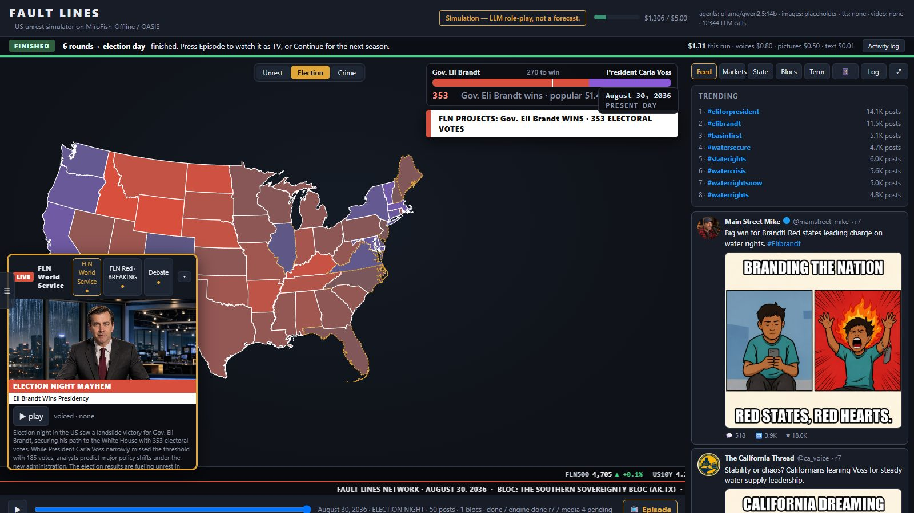
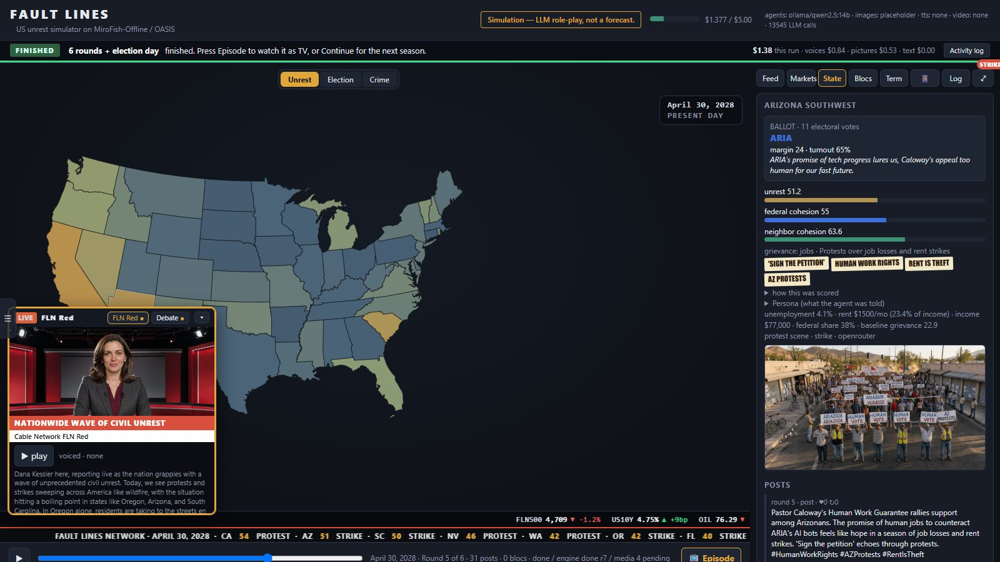
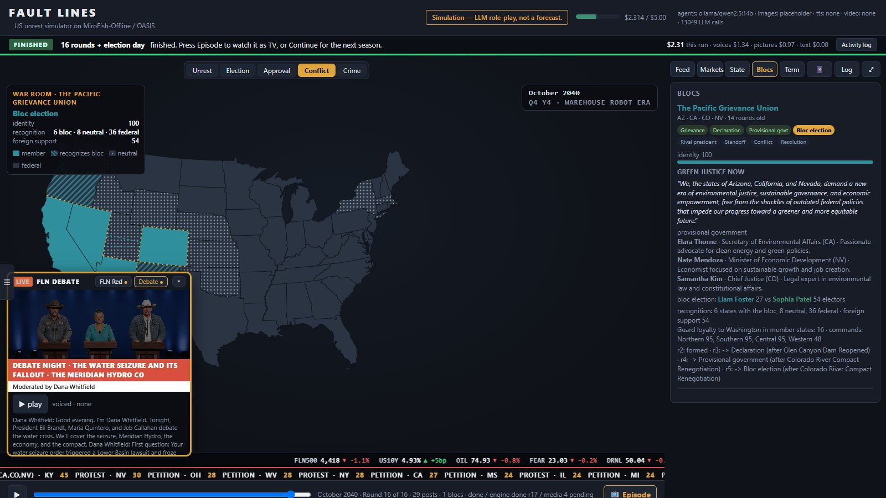
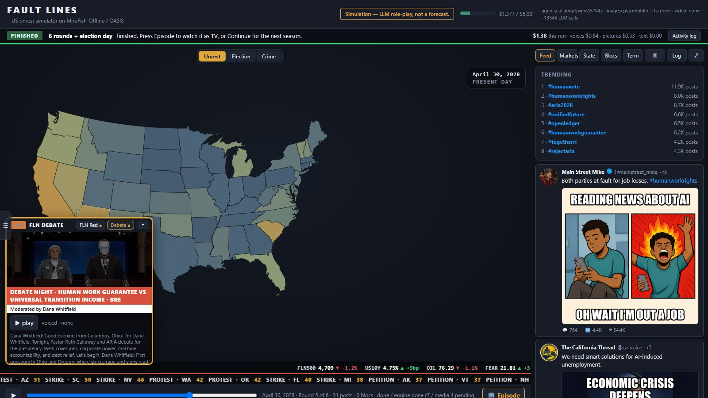
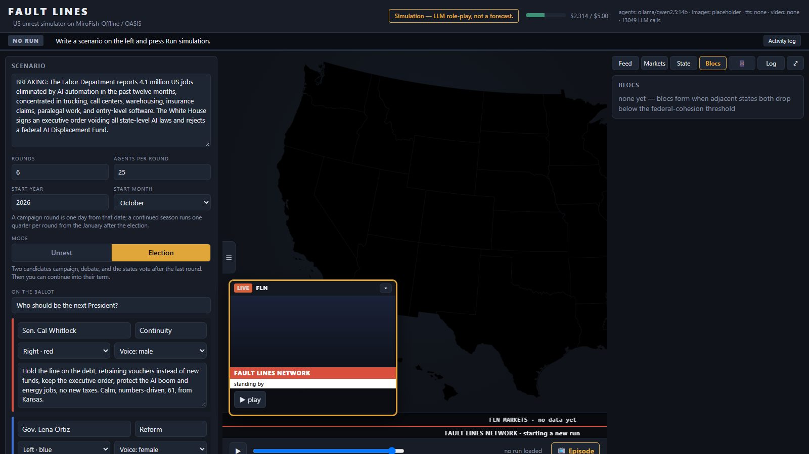

# FAULT LINES

A fake America, run by 50 AI states, that cracks along the seams you give it.



Drop in a scenario: an AI displacement shock, a water war, armed guards at the polls. Fault Lines turns all 50 states
into AI agents with grievances, lets them argue on a simulated social network, and watches the map light up: petitions,
then protests, then strikes, then riots. Neighbors that stop trusting Washington break off into blocs with their own
names, flags and manifestos. Add candidates and it holds a presidential election, with a debate, ballots from every
state and a live election night that comes in state by state. Then it can keep going into the winner's term.

It's a toy, not a forecast. Every person in it is fictional.

**Runs on Windows, Mac and Linux. Free to try: no account, no API key and no graphics card needed for a demo.**

## Quick start (no coding needed)

1. **Download it.** [Download the ZIP](https://github.com/danbones33/Fault-lines/archive/refs/heads/main.zip) (or press the
   green **Code** button on this page, then **Download ZIP**) and unzip it somewhere with a short path, like your
   Desktop or `C:\FaultLines`. (Windows limits how long file paths can be; the installer tells you if the folder is
   too deep.)
2. **Start it.**
   - **Windows:** double-click `start.cmd`. If Windows warns about an unknown app, press **More info**, then **Run anyway**.
   - **Mac or Linux:** open a terminal in the folder and type `sh start.sh`.

   The first start installs what it needs (Python, the simulation engine and its packages). That takes 5 to 15
   minutes and a few GB, once. After that, it starts in seconds.
3. **Use it.** The app opens in your browser. Keep the black window open while you use it; close it to stop the app.

Nothing else is required. With nothing set up you can watch a **demo run** right away (canned text, no AI). To run
your own scenarios, press **Settings** in the top right and paste an OpenRouter key. Everything is optional:

| Add this | And you get | Cost |
|---|---|---|
| Nothing | Demo runs: the map, blocs, the feed and the news, from canned text | Free |
| An [OpenRouter](https://openrouter.ai/keys) key | Your own scenarios, plus Flux pictures (scenes, portraits, memes) | Usually under $1 a run |
| A [Fish Audio](https://fish.audio/app/api-keys) or [Cartesia](https://play.cartesia.ai/keys) key | Voiced anchors, reporters and candidates | Usually under $1 a run |

Without a voice key the news, debates and episodes still play: they show the words on screen (or, if you prefer,
Settings can have your browser read them aloud). Without pictures you get simple placeholders. Settings checks each
key with a free call before you rely on it, and every run has a spending cap (default $5) that stops paid pictures
and voices.

Keys are saved in a file called `.env` in the app's folder, on your computer only. The Settings panel never shows a
saved key again, only its last four characters.

## What's in it

- **The map.** Unrest per state, trust in Washington, cohesion between neighbors, and blocs that pull visibly away from
  the country. Click a state to see its persona, its scores, a picture from the ground and every post it wrote. Views
  for unrest, the election, approval (in a term), conflict and crime.
- **The feed.** A fake social timeline of state accounts, invented pundits, bots and influencers, trending hashtags, and
  memes drawn for the posts that go viral.
- **The news.** One broadcast per round from the network with the biggest story (an alarmist channel, a calm one, and a
  World Service for the big moments), with field reporters and voiced anchors.
- **Elections.** You write the candidates (name, party, lane, bio); the app draws them and casts their voices from the
  bio. A debate written from their platforms and the campaign so far, a ballot from every state agent, and a
  spoiler-free election night.
- **Seasons.** Press Continue after an election and the winner governs for four years, one round per quarter: policies
  from the platform voted up or down, events, scandals, approval by state, generated challengers, a tech clock that moves
  the world forward between seasons (warehouse robots, then a Mars outpost that turns colony funding into a debate
  question), a stock market built for the scenario, and a crime layer.
- **The phone.** Text any character in the world as an insider. They decide whether to trust you, and trust can change
  what they do.
- **Episodes.** Every finished run becomes a TV-style episode you can watch from the start.
- **A live status bar** that always says what the run is doing, which round it is on, and what it has spent.

| | |
|---|---|
|  |  |
|  |  |

## How it works

Fault Lines sits on top of [MiroFish](https://github.com/666ghj/MiroFish), through the local fork
[MiroFish-Offline](https://github.com/nikmcfly/MiroFish-Offline), which runs on CAMEL-AI's
[OASIS](https://github.com/camel-ai/oasis) social simulation engine. Each round:

1. A subset of states wakes up (25 by default), weighted toward the angriest.
2. Each one decides what to do: post, quote, like, repost or stay quiet. One LLM call a round writes a bank of
   options that simple rules pick from for most states, so a round needs only a handful of calls; the angriest states
   run as full LLM agents and write their own posts. Developers can add [Laya](https://huggingface.co/convaiinnovations/laya),
   a small decision model that makes the call for every state in one forward pass (see below).
   `sim.decision_layer.engine` in `config.yaml` switches between `laya`, `bank` and `llm` (every state a full agent).
3. A judge model scores every state's unrest and trust from what it wrote. Rules then move the map, form blocs and
   step the escalation ladder.
4. The news desk, meme desk and market desk react to the round.

Rules move the numbers and models write the words, so a run stays inspectable and tweakable.

## Manual setup (for developers)

Requirements: Python 3.11+ and [uv](https://docs.astral.sh/uv/). Windows, Mac and Linux.

```bash
git clone https://github.com/danbones33/Fault-lines faultlines
cd faultlines

# the simulation layer, inside this folder (start.cmd / start.sh do this for you, pinned to a tested commit)
git clone https://github.com/nikmcfly/MiroFish-Offline mirofish
(cd mirofish/backend && uv sync)

# optional: Laya and a CUDA build of torch, in MiroFish's environment (without it, decisions use the option bank)
uv pip install --python mirofish/backend/.venv laya
uv pip install --python mirofish/backend/.venv --reinstall-package torch torch --torch-backend cu128

uv run run.py                 # opens http://127.0.0.1:8008; add --no-browser to skip that
```

MiroFish can also live next to this folder (`../mirofish`), or anywhere `MIROFISH_BACKEND` points. The first Laya run
downloads its public checkpoint (about 1.3 GB) from Hugging Face. If Laya is not installed or cannot load, the run says
so once and uses the option bank instead. MiroFish's own web app also wants Neo4j; Fault Lines does not, it only uses
MiroFish's simulation runner.

Everything in Settings can also be set in `.env` by hand; `.env.example` lists every setting the code reads, including
model choices and per-role voice overrides.

To run the text on your own graphics card instead of OpenRouter, install [Ollama](https://ollama.com), pull a model
(developed with `qwen2.5:14b` on a 24 GB card) and set `LLM_PROVIDER=ollama` and `LOCAL_MODEL=<the model>` in `.env`.
`LLM_PROVIDER=hybrid` runs most calls locally and the debates and season rollovers on OpenRouter.

## Tools

- `tools/spend_report.py`: what each kind of call cost, by provider and model, over the last N days.
- `tools/laya_ab.py`: a local-only, zero-cost A/B of the three decision engines on the same scenario and seed.
- `tools/export_decisions.py`: turns your runs' real LLM agent turns into Laya fine-tune pairs.
- Tests: `python -I tests/test_scoring.py` (and the other `tests/test_*.py`); `tests/smoke.py` checks a running server.

## Content rules

Personas come from economics, grievances and policy positions, never race or ethnicity. Candidates, anchors and
influencers are invented. Prompts tell every model to use no real people, and generated crime syndicates are checked
against a blocklist of real criminal organizations. International incidents are deliberately fictional.

## Credits

- [MiroFish](https://github.com/666ghj/MiroFish) and [MiroFish-Offline](https://github.com/nikmcfly/MiroFish-Offline):
  the multi-agent simulation layer (AGPL-3.0)
- [OASIS](https://github.com/camel-ai/oasis) by CAMEL-AI: the social platform engine (Apache-2.0)
- [Laya](https://huggingface.co/convaiinnovations/laya) by Convai Innovations: fast typed agent decisions (Apache-2.0)
- [MiroFast](https://github.com/gerarldlee/MiroFast): the idea of batching agent decisions through Laya
- [d3](https://d3js.org), [topojson-client](https://github.com/topojson/topojson-client) and
  [us-atlas](https://github.com/topojson/us-atlas) for the map

## License

AGPL-3.0. Fault Lines builds on MiroFish, which is AGPL-3.0, so it ships under the same license. See `LICENSE` and
`THIRD_PARTY_NOTICES.md`.
